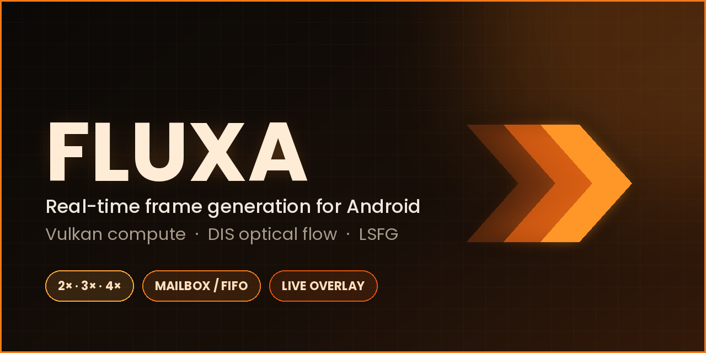

# Fluxa

> เดิมชื่อ FrameGen — รีดีไซน์ UI ใหม่ ธีมส้ม-ดำโทนอุ่น (ถนอมสายตา) ไล่เฉด amber → orange → ember

แอพ Android ที่ห่อ engine frame generation จาก WinNative (DIS optical flow + Vulkan compute) ให้ใช้เดี่ยวๆ

Pipeline: MediaProjection (แอพเดียว) → producer Surface (AImageReader) → fx_present.c (Vulkan, DIS) → overlay SurfaceView

## Build
Android Studio (Ladybug+) → Open โปรเจกต์นี้ → ติดตั้ง NDK + CMake จาก SDK Manager → Run
ต้องมี `glslc` ใน NDK (`<ndk>/shader-tools/...`, NDK r26 ขึ้นไปมี) ใช้คอมไพล์ shader DIS ตอน build

## ที่เพิ่ม/เปลี่ยนจาก extraction
- `shared/vk_driver.h` — แทนของ WinNative (ใช้ libvulkan.so ของเครื่อง ไม่ใช้ Turnip)
- `bin2c.cmake`, `CMakeLists.txt` — build ใหม่แบบสแตนด์อโลน
- Kotlin: `MainActivity`, `CaptureService` (+ `Fluxa*.kt` ชั้นควบคุม presenter)

## โหมด ปกติ / อัดจอ
เลือกในการ์ด "โหมด" บนหน้าแรก
- **ปกติ** — ทำงานเหมือนเดิม ไม่อัดอะไร
- **อัดจอ** — เอา *เฟรมที่แสดงบนจอ* (รวมเฟรมที่เจนเพิ่ม + เฟรมจริง) ไปทำเป็น mp4 (H.264 + AAC) เก็บที่ `Movies/Fluxa`
  - ใช้เส้นทางเดิม ไม่มี capture ใหม่: `fx_present.c` blit ทุกเฟรมที่ present ลง swapchain ตัวที่สองซึ่งชี้ไปที่ input surface ของ MediaCodec (`fx_rec_*`) ใน command buffer/queue เดียวกัน
  - เสียง: **เสียงแอพ** (AudioPlaybackCapture บน MediaProjection เดิม) หรือ **เสียงแอพ + เสียงนอก** (ผสมไมโครโฟน)
  - แนววิดีโอ: **แนวนอน / แนวตั้ง** (ถ้าแนวเกมไม่ตรงจะ aspect-fit มีขอบดำ) ความละเอียดสูงสุดด้านยาว 1920px
  - เวลาของเฟรมเจนถูกกระจายตาม fps ขาออก (`ScreenRecorder.videoLoop`) เพราะเฟรมที่ present ติดกันจะได้ timestamp เกือบเท่ากัน
  - ต้องอนุญาต `RECORD_AUDIO` (ถ้าไม่อนุญาตจะอัดแค่ภาพ) ระหว่างอัดจะมี ● mm:ss ที่ HUD/แผงควบคุม

## ดู Log
ปุ่ม **Log** (แถบล่างหน้าแรก และในแผงควบคุมตอนอยู่ในเกม) เปิดหน้า log: device info + crash Java ล่าสุด + logcat ของแอพ (รวม native tag `Fluxa`, `FluxaRecord`) กรอง Warn+Error ได้ มีปุ่ม รีเฟรช/คัดลอก/แชร์/ล้าง

## Overlay / สัมผัสทะลุ
overlay ใช้ `TYPE_ACCESSIBILITY_OVERLAY` ผ่าน `OverlayAccessibilityService` (Android 12+ บล็อกสัมผัสที่ทะลุ overlay ปกติที่ทึบ) ต้องเปิดบริการนี้ใน Settings → Accessibility ก่อนใช้ (ไม่ต้องใช้สิทธิ์ "แสดงทับแอพอื่น" แล้ว)

## ข้อจำกัด
- ยังไม่ได้ compile/ทดสอบบนเครื่องจริง (ส่วนอัดจอเช็ค syntax ฝั่ง C แล้ว ส่วน Kotlin ยังไม่ได้ build)
- ต้องเลือก "แอพเดียว" ตอนแชร์หน้าจอ (Android 14+) ไม่งั้น overlay ถูกจับซ้ำ

License: GPL (ตาม LICENSE ของ WinNative) — โค้ดทั้งโปรเจกต์ต้องเป็น GPL ด้วย

## Upscaling

When the screen resolution is lowered, the shown frames are upscaled back by the presenter
(`app/src/main/cpp/shared/presenter/fx_present.c`, `fx_upscale.c`). Pick the method in the
settings card (or live from the drawer panel):

| Mode | How |
| --- | --- |
| Nearest | `vkCmdBlitImage`, `VK_FILTER_NEAREST` - sharp, blocky |
| Linear | `vkCmdBlitImage`, `VK_FILTER_LINEAR` - smooth, soft (default) |
| Cubic | `VK_FILTER_CUBIC_EXT`; listed only after a run found the GPU supports it |
| Catmull-Rom | bicubic (B=0, C=0.5) compute pass, 9 bilinear fetches = exact 16-tap result, no extension needed (`shaders/up_catrom.comp`) |
| Lanczos | Lanczos-2, 4x4 taps, with a light anti-ringing clamp; sharper than Catmull-Rom (`shaders/up_lanczos.comp`) |
| SGSR | edge-adaptive single compute pass in the style of Snapdragon Game Super Resolution 1.x (own implementation, `shaders/up_sgsr.comp`) |
| NIS | edge-directed single compute pass in the style of NVIDIA Image Scaling: 4-direction edge map (NIS detection constants), Lanczos-2 across edges / smoothing along them, small built-in unsharp mask (own implementation, `shaders/up_nis.comp`; heaviest mode) |
| FSR1 | FidelityFX FSR 1 EASU compute pass (`shaders/up_easu.comp`) |

"Sharpness" adds a sharpen pass after any of them; **"Sharpen method"** picks which one:

| Method | How |
| --- | --- |
| RCAS | FSR 1 robust contrast-adaptive sharpening (`shaders/up_rcas.comp`), 5-tap cross |
| CAS | FidelityFX Contrast Adaptive Sharpening (`shaders/up_cas.comp`), 3x3 neighbourhood, amount adapts per colour channel to local contrast |

"Output resolution" sets the shown size as a percentage of the original screen resolution.

The newer shaders (Catmull-Rom, Lanczos, NIS, CAS) are optional at runtime: if a driver refuses one of
them the app logs it (tag `Fluxa`) and that mode falls back to a plain blit (CAS falls back to RCAS).

The EASU and RCAS shaders follow AMD FidelityFX Super Resolution 1.0 (MIT licence,
Copyright (c) 2021 Advanced Micro Devices, Inc.). The CAS shader follows AMD FidelityFX CAS (MIT licence,
Advanced Micro Devices, Inc.). The NIS mode is NOT NVIDIA's shader: it is an independent implementation
of the published idea (edge detection constants taken from NIS) and does not use NVIDIA's coefficient tables.

## Enhancement passes (denoise / AA / deband / dither)

Chain per shown frame (each stage is optional and only runs when its setting is on; they also run
when the output is **not** upscaled):

`source -> Denoise/Deblock -> FXAA or SMAA-lite -> upscale -> sharpen -> Deband + Dither -> screen`

| Pass | Where | How |
| --- | --- | --- |
| Denoise / Deblock | render size, before the upscale (`shaders/up_denoise.comp`) | edge-preserving bilateral filter (13-tap diamond) + light 8x8-grid deblock gated on small luma steps. Deblock is only fully effective when block-coded video is shown 1:1; elsewhere the grid is not aligned and it stays very gentle |
| FXAA | render size, before the upscale (`shaders/up_fxaa.comp`) | FXAA 3.11 quality algorithm (defaults 0.125 / 0.0312 / 0.75), compute version |
| SMAA-lite | render size, before the upscale (`shaders/up_smaa.comp`) | single-pass morphological AA: luma edge detection, edge search (12 px), L/Z/U end classification, area-based blend. **Not** the full 3-pass SMAA 1x (that needs the area / search lookup textures); it only touches pixels on detected edges |
| Deband | output size, last (`shaders/up_deband.comp`) | 2 iterations x 4 taps on a random ring (8..32 px); the pixel is pulled to the average only when all taps are within a small threshold, so real edges stay |
| Dither | same pass | triangular-PDF noise (+-1 LSB) before the 8-bit store |

Settings: card on the home screen + live in the in-game drawer (stored as `disp_enh_*`). The values travel
to native in the same packed int as the sharpen settings (bits 12..18 deband, 19..25 denoise, 26..27 AA,
28 dither), so the JNI signatures did not change. Denoise / AA need two extra render-size images per
frame slot (allocated only while one of them is on); if that allocation fails the passes are skipped and
the frame is shown normally. The still-image Compare screen uses the saved values.

Cost: every enabled pass is one more full-frame compute dispatch competing with frame generation, so enable
only what the content needs (FXAA / SMAA-lite and Denoise run at render size, which is the cheap place;
Deband runs at output size).
